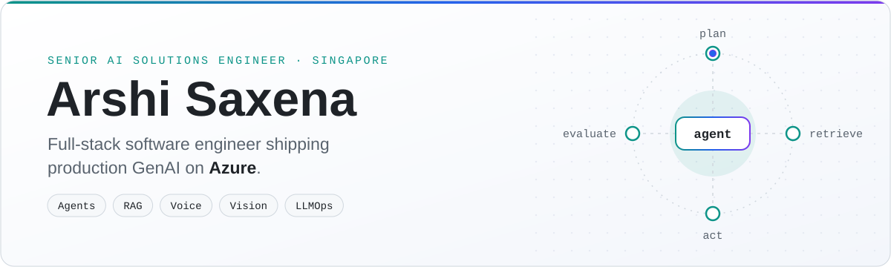
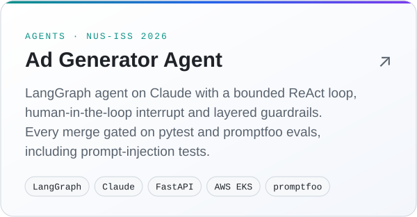
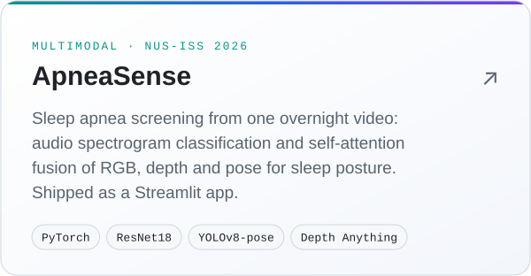

<picture>
  <source media="(prefers-color-scheme: dark)" srcset="assets/header-dark.svg">
  
</picture>

I started in information security, shipped full-stack enterprise apps, and now take GenAI from
stakeholder scoping to production on Azure as a Senior AI Solutions Engineer at T.D. Williamson.
That path is why I'm security-first and build the whole system, not just the prompt.

**Now:** building AI agents for field operations · learning Microsoft Fabric · making animated
explainers of AI concepts

### What I do

- **Production AI:** on a platform I'm building from scratch: an agentic RAG assistant deployed
  org-wide, a multimodal reporting agent, computer vision, real-time voice and LLM
  document-extraction pipelines.
- **Forward-deployed work:** scoping with domain experts and field teams, owning API contracts
  with partner engineering teams, and demoing to leadership.
- **Full-stack delivery:** enterprise web apps and APIs (Java/Spring Boot, Angular, React, Vue,
  PostgreSQL/MySQL) built in agile teams, from sprint planning through release.
- **AI-assisted development:** I build with AI coding agents every day, with tests, evals and
  review kept in the loop.

### How I build

<picture>
  <source media="(prefers-color-scheme: dark)" srcset="assets/terminal-dark.svg">
  
</picture>

### The system around the model

<picture>
  <source media="(prefers-color-scheme: dark)" srcset="assets/system-dark.svg">
  
</picture>

### Selected work

  <a href="https://github.com/architecting-ai-systems/DROPSHIPPING-BACKEND/tree/main/ad_generator"><picture><source media="(prefers-color-scheme: dark)" srcset="assets/card-ad-generator-dark.svg"></picture></a>
  <a href="https://github.com/sensingproject07/ApneaSense"><picture><source media="(prefers-color-scheme: dark)" srcset="assets/card-apneasense-dark.svg"></picture></a>

### Education

**MTech, Artificial Intelligence Systems**, National University of Singapore (NUS-ISS)

### Connect

<a href="https://www.linkedin.com/in/arshi-saxena"><picture><source media="(prefers-color-scheme: dark)" srcset="assets/linkedin-dark.svg"></picture></a>

